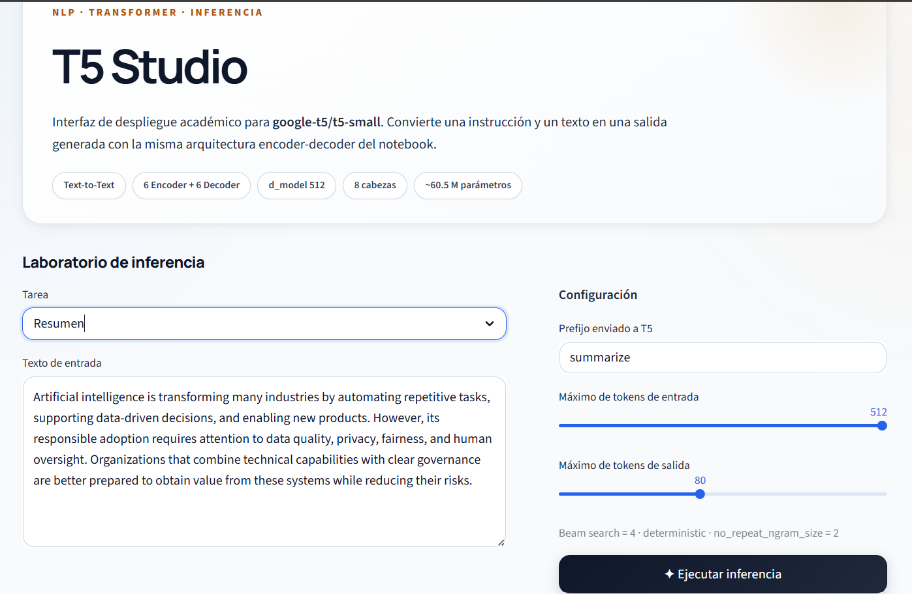
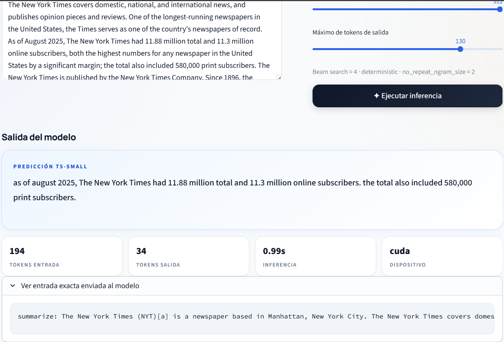
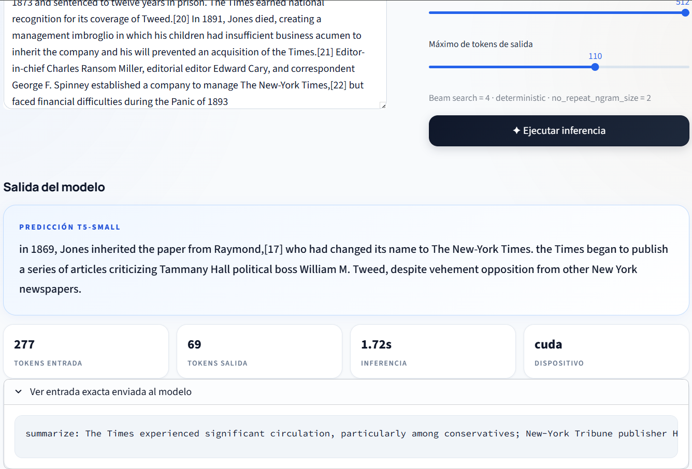
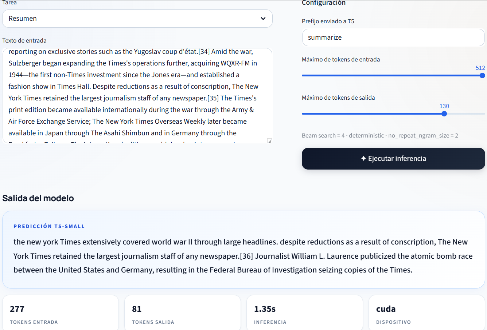
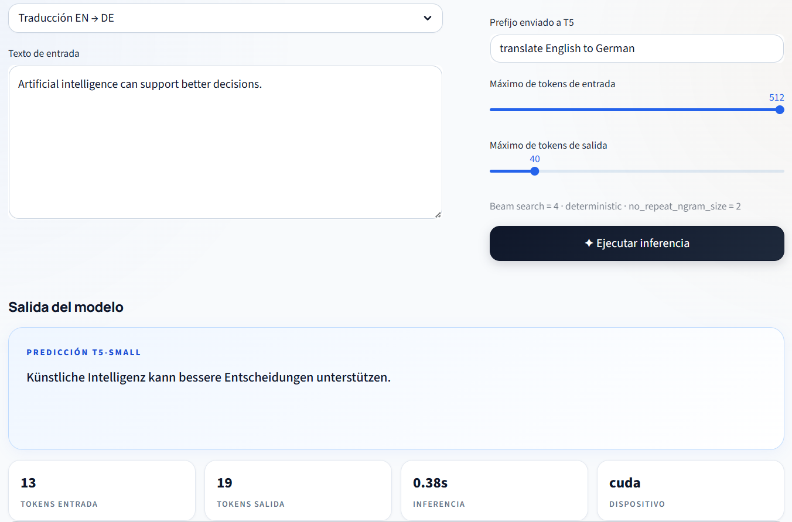

# T5 Studio — Inferencia texto a texto con T5-small

Aplicación académica para estudiar y desplegar **T5-small (Text-to-Text Transfer Transformer)** en tareas de Procesamiento de Lenguaje Natural. El proyecto implementa **resumen de texto en inglés** y una demostración de **traducción de inglés a alemán**, utilizando la misma arquitectura encoder-decoder y modificando el prefijo de la instrucción.

**Integrantes:** Omar Sánchez Jimenez, Santiago Correa Camapaña, Jorge Herrera y Wilson Jesus Riveros  
**Modelo:** `google-t5/t5-small`  
**Aplicación Streamlit:** `URL_STREAMLIT_PENDIENTE`  
**Artículo base:** *Exploring the Limits of Transfer Learning with a Unified Text-to-Text Transformer*  
**Repositorio original:** https://github.com/google-research/text-to-text-transfer-transformer

---

## 1. Resumen (Abstract)

Este proyecto implementa y despliega **T5-small**, una variante de la familia T5 propuesta por Raffel et al., con el objetivo de demostrar el paradigma **texto-a-texto** aplicado a tareas de NLP. En T5, tanto la entrada como la salida se representan como texto y la tarea se especifica mediante un prefijo textual, por ejemplo `summarize:` o `translate English to German:`.

La implementación utiliza el checkpoint preentrenado `google-t5/t5-small` mediante **PyTorch** y **Hugging Face Transformers**. El flujo comprende la preparación de la instrucción, tokenización, procesamiento mediante el encoder, generación autorregresiva con el decoder y decodificación del resultado. Para facilitar la interacción con el modelo se desarrolló una interfaz web en **Streamlit**, denominada **T5 Studio**, que permite seleccionar la tarea, ingresar texto, configurar la longitud máxima de entrada y salida, ejecutar la inferencia y visualizar métricas de tiempo, tokens y dispositivo.

Se realizaron pruebas propias de resumen y traducción. En las ejecuciones registradas en un entorno con CUDA se observaron tiempos aproximados entre **0,38 s y 1,72 s**, dependiendo de la longitud de entrada y salida. El trabajo tiene un propósito académico y demostrativo: se emplean pesos preentrenados y no se realizó fine-tuning ni una evaluación con conjuntos de referencia para calcular métricas de calidad como ROUGE o BLEU.

---

## 2. Introducción

### 2.1 Artículo base y repositorio original

El proyecto se basa en el artículo:

> C. Raffel *et al.*, “Exploring the Limits of Transfer Learning with a Unified Text-to-Text Transformer,” *Journal of Machine Learning Research*, vol. 21, no. 140, pp. 1–67, 2020.

Enlaces principales:

- Paper: https://arxiv.org/abs/1910.10683
- Publicación JMLR: https://jmlr.org/papers/v21/20-074.html
- Repositorio oficial de T5: https://github.com/google-research/text-to-text-transfer-transformer
- Checkpoint usado: https://huggingface.co/google-t5/t5-small

### 2.2 Contexto del problema

Las tareas de NLP pueden producir tipos de salida diferentes. Una clasificación genera una etiqueta, una traducción genera otra secuencia y un sistema de resumen produce una versión condensada del texto. T5 propone unificar estos problemas bajo una única formulación:

```text
texto de entrada → texto de salida
```

En este proyecto se aprovecha dicha formulación para ejecutar dos tareas:

```text
summarize: <texto>
translate English to German: <texto>
```

### 2.3 Motivación

Se seleccionó **T5-small** porque conserva los principios de la arquitectura T5 original y requiere menos recursos computacionales que T5-base, T5-large y variantes de mayor tamaño. Esto permite estudiar el comportamiento del Transformer encoder-decoder, ejecutar inferencia con pesos preentrenados y desplegar una interfaz interactiva sin entrenar el modelo desde cero.

### 2.4 Objetivo

Implementar **T5-small** para demostrar el proceso de inferencia texto-a-texto, estudiar el mecanismo de atención de la arquitectura Transformer y desplegar una interfaz en **Streamlit** que permita probar el modelo de manera interactiva.

---

## 3. Marco teórico

### 3.1 Arquitectura Transformer utilizada

T5 está basado en la arquitectura **Transformer** introducida por Vaswani et al. y utiliza una estructura **encoder-decoder**.

- **Encoder:** procesa la secuencia completa de entrada mediante autoatención bidireccional.
- **Decoder:** genera la salida de forma autorregresiva, token por token.
- **Atención cruzada:** permite que el decoder consulte las representaciones construidas por el encoder.

En el checkpoint **T5-small** utilizado en este proyecto se observan aproximadamente **60,5 millones de parámetros**, `d_model = 512`, **6 capas de encoder**, **6 capas de decoder** y **8 cabezas de atención**.

### 3.2 Mecanismo de atención

El mecanismo de atención escalada puede expresarse como:

```text
Attention(Q, K, V) = softmax((QKᵀ) / √dₖ) V
```

Donde:

- **Q (Query):** representa qué información busca la posición actual.
- **K (Key):** representa claves con las que se compara la consulta para estimar relevancia.
- **V (Value):** contiene la información contextual que se combina usando los pesos de atención.

#### Interpretación de Q, K y V para este problema

En la tarea de **resumen**, la atención cruzada encoder-decoder puede interpretarse así:

- **Q:** proviene del estado actual del decoder y representa qué información necesita para generar el siguiente token del resumen.
- **K:** proviene de las representaciones del texto original construidas por el encoder y permite determinar qué fragmentos son más relevantes para la consulta.
- **V:** también proviene del encoder y contiene la información contextual que será ponderada y combinada para continuar generando la salida.

De esta forma, el decoder puede consultar repetidamente el contenido codificado del texto original durante la generación.

### 3.3 Innovaciones de T5

Entre las ideas centrales del enfoque T5 se encuentran:

- **Marco unificado texto-a-texto** para múltiples tareas de NLP.
- **Prefijos de tarea** para indicar la operación que debe realizar el modelo.
- **Transfer learning**, reutilizando conocimiento adquirido durante el preentrenamiento.
- **Preentrenamiento por eliminación de ruido**, donde el modelo aprende a reconstruir segmentos ocultos.
- **Misma arquitectura encoder-decoder** para diferentes tareas, evitando diseñar una cabeza distinta para cada problema.

---

## 4. Metodología

El proceso seguido fue:

1. Selección del checkpoint `google-t5/t5-small`.
2. Configuración del entorno con Python, PyTorch, Transformers y SentencePiece.
3. Carga del tokenizador y de los pesos preentrenados mediante `from_pretrained()`.
4. Preparación de la entrada agregando el prefijo de la tarea.
5. Tokenización y truncamiento a un máximo configurable de tokens.
6. Inferencia con búsqueda por haces (`num_beams=4`) y generación determinista.
7. Decodificación de los tokens generados a texto.
8. Ejecución de pruebas propias de resumen y traducción.
9. Construcción de la interfaz **T5 Studio** con Streamlit.
10. Preparación del repositorio GitHub y despliegue en Streamlit Community Cloud.

### 4.1 Herramientas utilizadas

| Herramienta | Uso en el proyecto |
|---|---|
| Python | Lenguaje de implementación |
| PyTorch | Ejecución del modelo neuronal |
| Hugging Face Transformers | Carga de arquitectura, tokenizador y pesos |
| SentencePiece | Tokenización utilizada por T5 |
| Streamlit | Interfaz web del despliegue |
| Jupyter / Colab | Desarrollo y pruebas del notebook |
| GitHub | Versionamiento y publicación del código |
| Streamlit Community Cloud | Publicación de la aplicación web |

### 4.2 Uso de pesos preentrenados

El proyecto **no entrena T5 desde cero**. Se utilizan los pesos públicos del checkpoint:

```text
google-t5/t5-small
```

La carga se realiza con:

```python
from transformers import AutoTokenizer, AutoModelForSeq2SeqLM

MODEL_NAME = "google-t5/t5-small"

tokenizer = AutoTokenizer.from_pretrained(MODEL_NAME)
model = AutoModelForSeq2SeqLM.from_pretrained(MODEL_NAME)
```

La primera ejecución descarga los archivos del modelo. Después, el entorno puede reutilizar los archivos almacenados en caché.

---

## 5. Desarrollo e implementación

### 5.1 Estructura del repositorio

```text
T5-Studio/
├── app.py
├── README.md
├── requirements.txt
├── DEPLOYMENT.md
├── .gitignore
├── .streamlit/
│   └── config.toml
├── T5_Small_Inferencia_V1.ipynb
└── assets/
    ├── captura_1.png
    ├── captura_2.png
    ├── captura_3.png
    ├── captura_4.png
    └── captura_5.png
```

### 5.2 Ejecución local

Clonar el repositorio:

```bash
git clone <URL-DE-SU-REPOSITORIO>
cd t5-studio-inferencia
```

Instalar dependencias:

```bash
pip install -r requirements.txt
```

Ejecutar Streamlit:

```bash
streamlit run app.py
```

La aplicación estará disponible normalmente en:

```text
http://localhost:8501
```

### 5.3 Preprocesamiento

La entrada sigue este flujo:

```text
Texto del usuario
      ↓
Prefijo de tarea
      ↓
summarize: <texto>
      ↓
Tokenización T5
      ↓
input_ids + attention_mask
      ↓
Encoder
```

Código principal:

```python
model_input = f"{prefix}: {text.strip()}"

inputs = tokenizer(
    model_input,
    return_tensors="pt",
    max_length=max_input_tokens,
    truncation=True,
)
```

### 5.4 Inferencia

El proceso de generación usado tanto en el notebook como en la aplicación es:

```python
generated = model.generate(
    **inputs,
    max_new_tokens=max_output_tokens,
    num_beams=4,
    do_sample=False,
    no_repeat_ngram_size=2,
    early_stopping=True,
)
```

Interpretación de los parámetros principales:

- `num_beams=4`: búsqueda por haces con cuatro candidatos.
- `do_sample=False`: generación determinista.
- `no_repeat_ngram_size=2`: evita repetir bigramas durante la generación.
- `early_stopping=True`: permite detener la búsqueda cuando los haces finalizan según el criterio de generación.
- `max_new_tokens`: controla la longitud máxima de la salida generada.

La secuencia se convierte nuevamente a texto mediante:

```python
prediction = tokenizer.decode(
    generated[0],
    skip_special_tokens=True,
)
```

### 5.5 Interfaz de despliegue

La aplicación Streamlit permite:

- seleccionar **Resumen** o **Traducción EN → DE**;
- introducir o modificar el texto;
- visualizar el prefijo enviado a T5;
- modificar el máximo de tokens de entrada y salida;
- ejecutar la inferencia;
- visualizar la predicción;
- observar tokens de entrada y salida;
- medir el tiempo de inferencia;
- visualizar si se está ejecutando en `cuda` o `cpu`;
- consultar la entrada exacta enviada al modelo.



### 5.6 Despliegue público

La aplicación puede publicarse en **Streamlit Community Cloud** usando este mismo repositorio. Las instrucciones detalladas se encuentran en [`DEPLOYMENT.md`](DEPLOYMENT.md).

Una vez desplegada, reemplazar en este README:

```text
URL_STREAMLIT_PENDIENTE
```

por la URL pública real de la aplicación.

> **Nota:** Streamlit Community Cloud normalmente ejecutará la aplicación en CPU. Las capturas de las pruebas del proyecto fueron realizadas en un entorno con CUDA, por lo que el dispositivo y los tiempos pueden ser diferentes en el despliegue público.

---

## 6. Resultados y análisis

Las siguientes evidencias corresponden a **pruebas propias** realizadas sobre la interfaz desarrollada.

### 6.1 Resumen — prueba 1



Resultados registrados:

- **Tokens de entrada:** 194
- **Tokens de salida:** 34
- **Tiempo de inferencia:** 0,99 s
- **Dispositivo:** CUDA

La salida es sustancialmente más corta que la entrada, que es el comportamiento esperado de la tarea de resumen. El modelo selecciona información relevante y genera una secuencia condensada.

### 6.2 Resumen — prueba 2



Resultados registrados:

- **Tokens de entrada:** 277
- **Tokens de salida:** 69
- **Tiempo de inferencia:** 1,72 s
- **Dispositivo:** CUDA

La entrada y la salida son más extensas que en la prueba anterior. El tiempo de inferencia también fue mayor en esta ejecución.

### 6.3 Resumen — prueba 3



Resultados registrados:

- **Tokens de entrada:** 277
- **Tokens de salida:** 81
- **Tiempo de inferencia:** 1,35 s
- **Dispositivo:** CUDA

Aunque la cantidad de tokens de entrada es igual a la prueba anterior, el tiempo no es idéntico. La latencia depende de la longitud generada, el estado del entorno y el proceso de decodificación, no únicamente del tamaño de entrada.

### 6.4 Traducción inglés → alemán

Entrada evaluada:

```text
Artificial intelligence can support better decisions.
```

Salida obtenida:

```text
Künstliche Intelligenz kann bessere Entscheidungen unterstützen.
```



Resultados registrados:

- **Tokens de entrada:** 13
- **Tokens de salida:** 19
- **Tiempo de inferencia:** 0,38 s
- **Dispositivo:** CUDA

La prueba demuestra el enfoque texto-a-texto de T5: no fue necesario cambiar la arquitectura, únicamente el prefijo de la tarea.

### 6.5 Resumen cuantitativo

| Prueba | Tarea | Tokens entrada | Tokens salida | Tiempo | Dispositivo |
|---|---|---:|---:|---:|---|
| 1 | Resumen | 194 | 34 | 0,99 s | CUDA |
| 2 | Resumen | 277 | 69 | 1,72 s | CUDA |
| 3 | Resumen | 277 | 81 | 1,35 s | CUDA |
| 4 | Traducción EN → DE | 13 | 19 | 0,38 s | CUDA |

### 6.6 Análisis de desempeño

Las métricas registradas describen principalmente el **comportamiento operativo de la inferencia** y no constituyen por sí mismas una medida de calidad semántica. A partir de las pruebas se observa que:

- una misma arquitectura puede ejecutar tareas diferentes mediante un prefijo textual;
- las pruebas con entradas y salidas más largas demandaron mayor procesamiento que la traducción corta;
- CUDA permitió tiempos inferiores a dos segundos en los casos registrados;
- en resumen, las salidas fueron significativamente más cortas que las entradas;
- en traducción, el modelo generó una oración coherente en alemán para el ejemplo evaluado.

**Limitación:** no se utilizó un conjunto de referencia etiquetado, por lo que no se reportan métricas de calidad como **ROUGE** para resumen ni **BLEU** para traducción. Para obtenerlas correctamente sería necesario comparar las predicciones con resúmenes o traducciones de referencia.

---

## 7. Conclusiones

El proyecto permitió comprobar de manera práctica el principio central de T5: múltiples tareas de NLP pueden expresarse mediante una estructura **texto-a-texto**. Con T5-small fue posible ejecutar resumen y traducción utilizando la misma arquitectura encoder-decoder y cambiando únicamente el prefijo de entrada.

También se analizó el papel del mecanismo de atención y la relación entre **Q, K y V**. En la atención cruzada, el decoder utiliza una consulta asociada a su estado actual para localizar y recuperar información relevante de las representaciones producidas por el encoder.

El uso de pesos preentrenados permitió realizar inferencia sin entrenar el modelo desde cero. La integración con Streamlit transformó el notebook en una aplicación web que hace visible todo el flujo de entrada, configuración, inferencia y salida.

Entre las principales limitaciones se encuentran el uso de la variante pequeña del modelo, la ausencia de fine-tuning para un dominio específico, la dependencia del hardware para la latencia y la falta de referencias para evaluar automáticamente la calidad de las generaciones.

Posibles mejoras futuras:

- realizar fine-tuning sobre un dominio específico;
- comparar T5-small con modelos de mayor capacidad;
- incorporar datasets con referencias y métricas ROUGE/BLEU;
- analizar consumo de memoria y rendimiento en CPU/GPU;
- estudiar y visualizar mapas de atención;
- incorporar nuevas tareas texto-a-texto.

---

## 8. Referencias

[1] C. Raffel, N. Shazeer, A. Roberts, K. Lee, S. Narang, M. Matena, Y. Zhou, W. Li and P. J. Liu, “Exploring the Limits of Transfer Learning with a Unified Text-to-Text Transformer,” *Journal of Machine Learning Research*, vol. 21, no. 140, pp. 1–67, 2020. [Online]. Available: https://jmlr.org/papers/v21/20-074.html

[2] Google Research, “T5: Text-To-Text Transfer Transformer,” *GitHub*. [Online]. Available: https://github.com/google-research/text-to-text-transfer-transformer

[3] A. Vaswani *et al.*, “Attention Is All You Need,” in *Advances in Neural Information Processing Systems 30*, 2017. [Online]. Available: https://arxiv.org/abs/1706.03762

[4] Hugging Face, “T5,” *Transformers Documentation*. [Online]. Available: https://huggingface.co/docs/transformers/model_doc/t5

[5] Hugging Face, “google-t5/t5-small,” *Model Hub*. [Online]. Available: https://huggingface.co/google-t5/t5-small

[6] Streamlit, “Streamlit documentation.” [Online]. Available: https://docs.streamlit.io/
